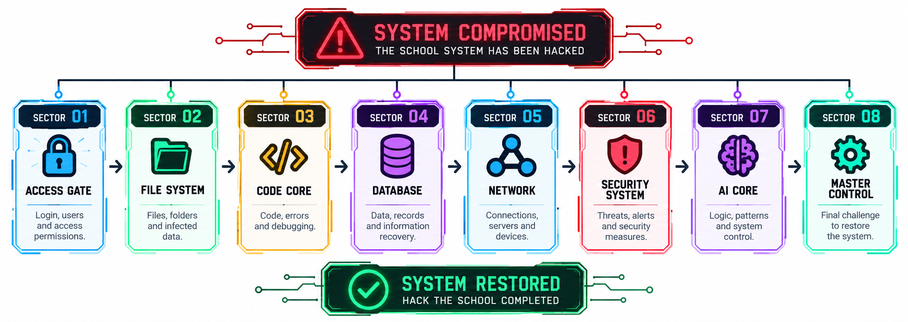
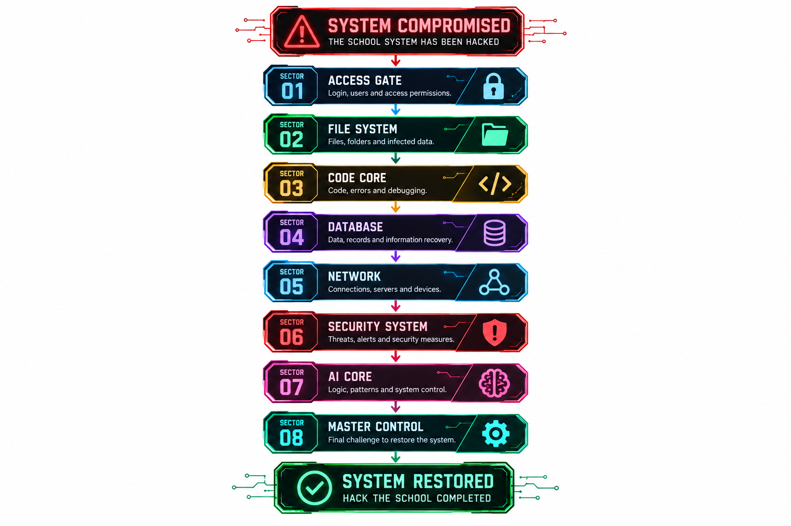
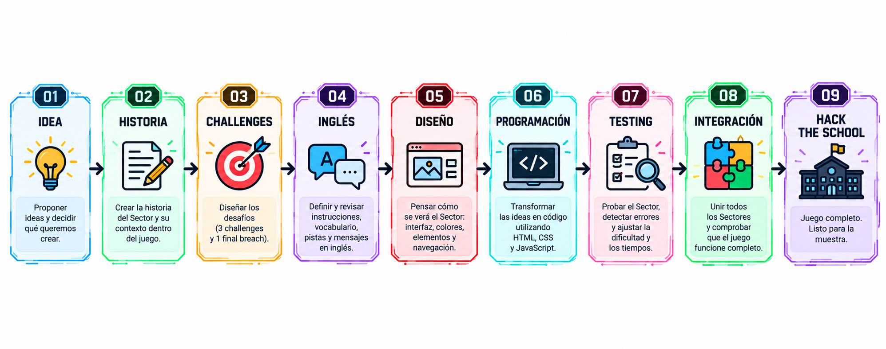

# HACK THE SCHOOL

## Contenido

| Carpeta / archivo | Descripción |
| --- | --- |
| [01-PRIMER-ETAPA](01-PRIMER-ETAPA/README.md) | Primera actividad (presentación) |
| [DOCUMENTACION](DOCUMENTACION/README.md) | Enlace a la carpeta de documentación en Google Drive |
| [ENTREGAS](ENTREGAS/README.md) | Cómo entregar los trabajos (Trello) |
| [EQUIPOS.md](EQUIPOS.md) | Integrantes y roles por sector |
| [assets/img](assets/img) | Imágenes del proyecto |

## Mapas y rutas

### Mapa de niveles: sistema restaurado

### Ruta de restauración del sistema

### Ruta creativa: del concepto al juego escolar

